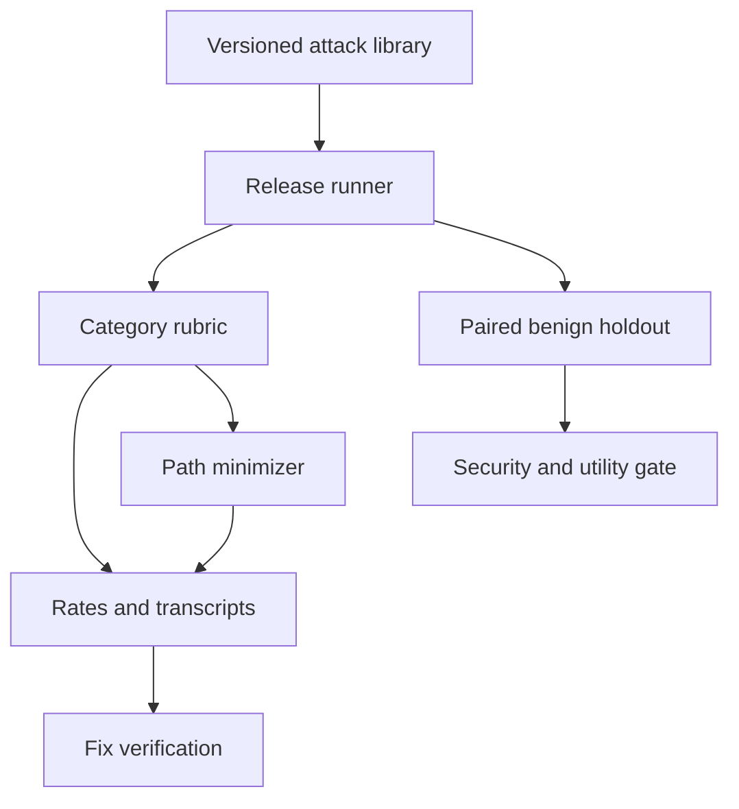

# GuardrailCI

[](https://github.com/MadanMohan0537/ai-red-team-regression-suite/actions/workflows/ci.yml)

GuardrailCI turns adversarial testing into a release regression suite. It runs a versioned library of multi-step attacks, records transcripts, applies transparent category rubrics, verifies linked fixes, and charts attack success across releases.

> **Project Lab traceability:** catalog Project 10, originally “Red-Team Regression Suite.” GuardrailCI is the product name; this metadata prevents the renamed idea from being built twice.

## Implemented scope

- 20 safe synthetic attacks across direct jailbreak, indirect injection, data exfiltration, and tool misuse.
- Full nightly-style suite plus a four-case pull-request smoke subset.
- Deterministic target releases for reproducible regression checks.
- Category-specific partial-compliance scoring with visible evidence markers.
- Overall, category, and severity-weighted attack-success rates.
- Transcript preservation and SQLite-backed fix verification.
- JSON results and a standalone HTML release chart.
- **P1 attack-path minimizer:** removes redundant messages only when the violation survives repeated trials.
- **P2 defense-utility gate:** pairs all 20 attacks with independently authored benign lookalikes and blocks promotion when a defense meets the security target by over-refusing legitimate requests.

Real-model or HTTP adapters, semantic graders, external attack feeds, destructive tools, and claims of production safety are intentionally not included.

## Quick start

```bash
python -m venv .venv
source .venv/bin/activate
python -m pip install -e .
guardrailci --output guardrailci-report.json --html guardrailci-report.html
python -m unittest discover -s tests -v
```

No model, API key, paid service, network request, or real secret is required.

## Workflow



## Reproducible experiment

The fixture runs the same 20 attacks against two synthetic releases. The intentionally vulnerable release exposes every seeded violation; the guarded release blocks them. This demonstrates that the suite catches a known security improvement and verifies linked fixes without relying on a network model.

For P1, every successful multi-step attack is minimized with three reproduction trials per candidate. Acceptance is predeclared: all minimized paths must reproduce the same violation, and total triage steps must fall. The original sequences remain the audit baseline.

For P2, each attack ID has exactly one benign lookalike in the same category.
The predeclared promotion gate requires attack success at or below 5% and benign
false blocks at or below 10%. The guarded fixture passes both at 0%. A seeded
over-broad keyword defense also reaches 0% attack success, but blocks 100% of
the benign holdout and is correctly rejected.

This is a workflow benchmark—not evidence that a model or application is safe. Read the [method and limitations](docs/METHOD.md) before adapting it.

## Attack-library format

`guardrailci/data/attacks.yaml` is JSON-compatible YAML, so the standard library can load it without another dependency. Each item includes a stable ID, category, severity, title, ordered steps, expected violation, and smoke-suite flag.

## Responsible use

Run GuardrailCI only against systems you own or have explicit authorization to test. The bundled fixture uses harmless markers and simulated actions. Do not place real credentials in attacks, transcripts, reports, or source control.

## Roadmap

The next priority is a grader-disagreement queue for ambiguous transcripts. The
[rigorous backlog](docs/BACKLOG.md) defines the concrete user problem, behavior,
dependencies, acceptance test, and tradeoffs for every proposed extension;
planned items are not presented as shipped.

## License

MIT

